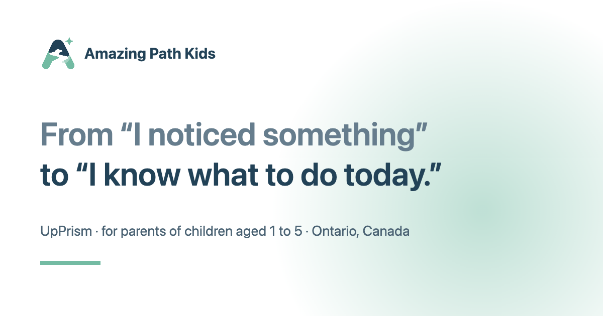

# Amazing Path Kids — Website



[](https://amazingpathkids.com)
[](https://vercel.com)

The marketing website for **[amazingpathkids.com](https://amazingpathkids.com)**, home of **UpPrism**: a calm, plain-language app that helps parents of children aged 1 to 5 make sense of what they notice, choose what to work on, and do one useful activity at home.

> UpPrism does not diagnose. Made in Ontario, Canada.

---

## Overview

This is a static website with no build step. Every page is a self-contained HTML file. A small runtime (`support.js`) renders the shared header and footer and handles interactive components in the browser.

| Page                | File                | URL             |
| ------------------- | ------------------- | --------------- |
| Home                | `index.html`        | `/`             |
| How it works        | `how-it-works.html` | `/how-it-works` |
| About               | `about.html`        | `/about`        |
| Contact and support | `contact.html`      | `/contact`      |
| Privacy Policy      | `privacy.html`      | `/privacy`      |
| Terms of Use        | `terms.html`        | `/terms`        |
| Not found           | `404.html`          | —               |

## Tech stack

- Plain HTML and CSS, no framework build or bundler
- [React 18.3.1](https://react.dev) and Babel Standalone, loaded from unpkg at runtime by `support.js`
- [Figtree](https://fonts.google.com/specimen/Figtree) from Google Fonts
- [Vercel](https://vercel.com) for hosting

## Project structure

```
.
├── index.html              # Home page
├── how-it-works.html
├── about.html
├── contact.html
├── privacy.html
├── terms.html
├── 404.html                # Custom not-found page
├── Site Header.dc.html     # Shared navigation (loaded at runtime)
├── Site Footer.dc.html     # Shared footer (loaded at runtime)
├── support.js              # Page runtime (generated; do not edit by hand)
├── assets/                 # Logos, icons, Open Graph image, product imagery
├── favicon.ico
├── site.webmanifest        # PWA manifest
├── robots.txt
├── sitemap.xml
└── vercel.json             # Vercel config (clean URLs)
```

## Running locally

The pages use root-relative paths (`/assets/...`) and load shared partials over HTTP, so they must be served from a local web server. Opening the files directly with `file://` will not work.

```bash
npx serve .
```

Then open <http://localhost:3000>. `serve` supports clean URLs, so `/about` resolves to `about.html` just as it does in production.

## Deployment

The site is deployed to **Vercel**. `vercel.json` enables clean URLs (`/about` instead of `/about.html`) and removes trailing slashes.

## Development notes

- **Shared header and footer.** Navigation and footer live in `Site Header.dc.html` and `Site Footer.dc.html`. Pages reference them by filename, so do not rename these files.
- **Runtime.** `support.js` is a generated bundle. It loads React and Babel from `unpkg.com` at runtime, so visitors need access to that CDN for pages to render.
- **SEO.** When adding or renaming a page, update `sitemap.xml`, and set the page's `<title>`, meta description, canonical URL, and Open Graph tags.
- **Links.** Use clean, root-relative URLs (for example `/how-it-works`, not `how-it-works.html`).

## Contact

Questions about the site or UpPrism: [founder@amazingpathkids.com](mailto:founder@amazingpathkids.com)

## License

This repository is proprietary. All content, branding, and imagery are © 2026 Amazing Path Kids. All rights reserved. No license is granted to copy, modify, or redistribute any part of it.
